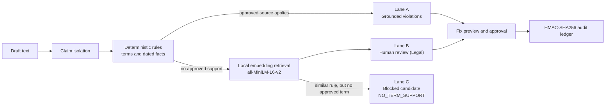
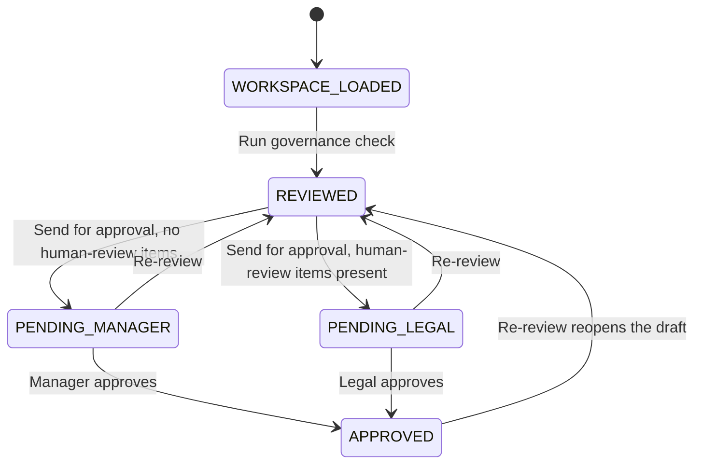

<div align="center">

# 🛡️ BrandSentinel AI

### Pre-publication brand governance that cites its sources, or stays silent.


**CodeNexus India 2026 · Round 2: The Build · Problem statement by Inkloom AI**

</div>

BrandSentinel AI reviews content *before* it is published, flags unsupported or outdated claims against approved sources, and proposes corrections instead of simply rejecting. Every finding is traceable to a rule or a dated fact, every approval is bound to the exact text that was reviewed, and every step lands in a tamper-evident audit ledger.

---

## ⚡ Try it in 90 seconds

1. Open the app. A scenario is already loaded, with no login.
2. Press **Run governance check**. Findings appear in three lanes, with measured timings above them.
3. In **Lane A**, open *Why this finding?*, then **Preview fix** and **Apply change**.
4. Press **Run governance check** again, then **Send for approval**, then **Approve**.
5. Open **Audit ledger**, press **Verify chain**, then **Simulate tamper** and watch the broken block turn red and the later blocks turn grey.

| Scenario | What it demonstrates |
|---|---|
| **Expired fact** | A fact past its approval date and a banned superlative are both reported on one sentence |
| **Banned superlative** | A rule violation with a deterministic rewrite you can preview |
| **Unverified claim** | A claim with no approved source goes to a human, never to a verdict |

---

## 🎯 Problem and solution

Organisations publish through employees, agencies and generative AI tools, and nobody sees every draft first. In our own survey of **18 practitioners**, **17 of 18** use generative AI to draft content, **14 of 18** verify drafts against official guidelines only rarely or inconsistently, and **outdated facts, pricing or statistics** were the most reported error (**8 of 18**).

Most "AI brand checkers" ask a language model whether a draft looks wrong, which can invent a rule that does not exist. BrandSentinel AI takes the opposite approach:

| Principle | How it works |
|---|---|
| 🧭 **Coach, don't gatekeep** | Each issue is explained, cites its source, and comes with a previewable fix. Nothing is rewritten automatically |
| 🤐 **Cite or stay silent** | A violation is only asserted when a rule or dated fact supports it. Anything else is routed to a human and never called a violation |
| 👥 **Human-in-the-loop** | Approval needs the right role, and the server blocks it if the text changed after review |

No generative model sits in the decision path. Results are reproducible, run in milliseconds, and draft text never leaves the server for embedding.

---

## 🏗️ Architecture



### Workflow states



| Layer | Responsibility |
|---|---|
| **Next.js 14 frontend** | Content workspace, three-lane command center, diff preview, stale-draft banner, audit modal with chain visualisation |
| **FastAPI backend** | Typed API, request validation, masked errors, env-driven CORS, startup warm-up |
| **Policy and RAG engine** | Claim isolation, whole-word rules, dated-fact evaluation, local vector retrieval, measured timing trace |
| **Session store** | UUID-keyed isolated sessions, each with its own workflow and ledger, with expiry and size caps |
| **Workflow state machine** | Role-aware transitions enforced on the server |
| **Audit ledger** | Canonical JSON plus HMAC-SHA256 hash chain, thread-safe, with sandbox tamper simulation |

---

## ✨ Features

### 🚦 Three-lane governance
- **Lane A: Grounded violations.** Offending words are highlighted, with rule ID, section, source passage and expiry date where relevant.
- **Lane B: Needs human review.** Claims with no approved source (or a source not yet in effect) go to Legal. The server, not the browser, decides this.
- **Lane C: Blocked candidates.** When retrieval proposes a nearby rule (cosine similarity 0.28 or higher) but the claim contains none of that rule's approved terms, the candidate is recorded with reason code `NO_TERM_SUPPORT`. You can see what the system chose *not* to assert.
- **Dated facts.** Expired and not-yet-effective facts are detected by date arithmetic, not by a model.

### 🔍 Interactive diff preview
- Proposed rewrites show removed text (strikethrough) and added text (green) before anything changes.
- Apply or cancel. Findings with no safe rewrite give advice instead of an Apply button.

### 🧊 Stale-draft prevention
- Editing after a review shows a banner and disables **Send for approval** and **Approve** until the draft is reviewed again.
- The server enforces the same rule: approval actions must present text whose SHA-256 matches the reviewed text, otherwise the API returns `409 Conflict`.

### 🔐 Tamper-evident audit ledger
- Every event is chained: canonical JSON, the previous block's hash, and a keyed HMAC-SHA256 digest.
- Appends are protected by a lock. The ledger stores content hashes and rule IDs, not draft text.
- **Verify chain** reports the first broken block, if any.
- **Simulate tamper** alters the middle block of a **sandbox copy**, re-verifies, and shows blocks as 🟢 verified, 🔴 broken or ⚪ unverifiable. The live ledger is never touched.

### 🧱 Enterprise safety controls
- **Session isolation:** one random UUID per visitor, with an isolated workflow and ledger.
- **Server-derived Legal routing:** a client-sent `needs_legal` value is ignored.
- **Role enforcement on the server:** Creators cannot approve, and only the required approver can sign off.
- **Safe failures:** unexpected errors return masked JSON, validation errors are readable, and the UI offers a retry instead of crashing.

---

## 🧰 Tech stack

| Area | Technology |
|---|---|
| **Frontend** | Next.js 14, React, TypeScript, Tailwind CSS |
| **Backend** | FastAPI, Pydantic, Starlette, Uvicorn |
| **Retrieval** | `sentence-transformers` with `all-MiniLM-L6-v2`, run locally, passages encoded once at startup |
| **Security** | HMAC-SHA256 hash chain, canonical JSON, SHA-256 content binding, UUID session isolation, server-side RBAC |
| **Testing** | `unittest`-compatible suites runnable with `pytest`, plus the Next.js production build |

---

## 🚀 Local installation (for judges)

**Prerequisites:** Python 3.10+, Node.js 18+, Git. The first start with embeddings enabled downloads the ~90 MB model once.

### 1. Backend

```bash
cd backend
python -m venv .venv
source .venv/bin/activate          # Windows: .venv\Scripts\activate
pip install fastapi "uvicorn[standard]" sentence-transformers pytest httpx

export LEDGER_HMAC_KEY="change-me-to-a-long-random-string"   # Windows PowerShell: $env:LEDGER_HMAC_KEY="..."
uvicorn app.main:app --host 0.0.0.0 --port 8000
```

Check `http://localhost:8000/api/health`. `retrieval_mode` should read `embedding`. If it reads `lexical_fallback`, the model could not be loaded and a simpler word-overlap matcher is being used. The UI shows the same label.

### 2. Frontend

```bash
cd frontend
npm install
echo "NEXT_PUBLIC_API_URL=http://localhost:8000" > .env.local
npm run dev
```

Open `http://localhost:3000`.

For a production build: `npm run build && npm start`.

### Configuration

| Variable | Purpose | Default |
|---|---|---|
| `LEDGER_HMAC_KEY` | Secret key for the audit chain. Set it for any real use | insecure dev key, with a warning |
| `ALLOWED_ORIGINS` | Comma-separated frontend origins allowed by CORS | `http://localhost:3000` |
| `ALLOWED_ORIGIN_REGEX` | Optional origin pattern, for example `https://.*\.vercel\.app` | unset |
| `EMBEDDING_LOCAL_ONLY` | `1` stops the startup model download (use after the first run) | `0` |
| `DISABLE_EMBEDDINGS` | `1` forces the lexical fallback | `0` |
| `NEXT_PUBLIC_API_URL` | Backend URL used by the frontend, **set at build time** | `http://localhost:8000` |

---

## 🧪 Testing and verification

```bash
cd backend
pytest -v
# or, with no extra dependencies:
python -m unittest discover -s tests -v
```

| Suite | Covers |
|---|---|
| `tests/test_core.py` | Rule and date logic, Lane A/B/C routing, measured timings, ledger integrity, mid-chain tamper statuses, concurrent appends, session isolation, content binding, server-derived Legal routing, re-review after approval |
| `tests/test_api.py` | HTTP behaviour: full approval flow, `409` on changed text, `403` on wrong role, a client-sent `needs_legal: false` being ignored, JSON validation errors, masked `500`s, CORS, tamper simulation. Skipped automatically if FastAPI or `httpx` is missing |

Quick manual API check:

```bash
curl -s -X POST localhost:8000/api/session -H "Content-Type: application/json" -d '{"scenario":"expired"}'
curl -s localhost:8000/api/health
```

Interactive API docs are at `http://localhost:8000/docs`.

<details>
<summary><b>API reference</b></summary>

| Endpoint | Purpose |
|---|---|
| `POST /api/session` | Create an isolated session and load a scenario |
| `POST /api/review` | Run the governance check, store the content hash, derive Legal routing |
| `POST /api/action` | Send for approval or approve, with role and content-hash checks |
| `GET /api/audit` | Ledger entries plus verification result |
| `GET /api/audit/verify` | Re-verify the chain |
| `POST /api/audit/simulate-tamper` | Tamper with a sandbox copy and return before and after verification |
| `GET /api/health` | Service status and retrieval mode |

Limits: drafts up to 20,000 characters; sessions expire after one hour; each ledger holds up to 500 entries.

</details>

---

## 📁 Project structure

```
backend/
  app/main.py                 API routes, typed errors, CORS, startup warm-up
  app/core/rag_engine.py      Rules, dated facts, retrieval, lanes, timing trace
  app/core/sessions.py        Isolated sessions, Legal routing, content binding
  app/core/workflow.py        Role-aware approval state machine
  app/core/audit_ledger.py    HMAC-SHA256 chain, verification, tamper simulation
  tests/                      test_core.py, test_api.py
frontend/
  src/app/page.tsx            Workspace, lanes, diff preview, audit modal
```

---

## ⚠️ Known limitations

We list these so you do not have to find them.

- State and ledgers are **in memory** and reset on restart.
- Roles are **selectable in the demo** because there is no identity provider. The server enforces which role may do what, but it cannot prove who is acting.
- The ledger makes tampering **evident, not impossible**. Deleting the newest entries cannot be detected from inside the chain, and someone holding the HMAC key could rewrite it. Anchoring the head hash outside the process is planned.
- The demo knowledge base is small and **synthetic** (four policy sources). Detection quality on real rulebooks is not yet measured.
- Text only. Images, documents, comments and revision history are not part of this build.
- Similarity thresholds were set by hand for the demo and need calibration on a larger set.

---

## 🗺️ Roadmap

**Committed for Round 3**

| # | Improvement | Outcome |
|---|---|---|
| 1 | **Signed compliance audit report (PDF)** | An evidence pack with content hash, citations, decisions and verified ledger, signed with Ed25519 and checkable offline |
| 2 | **Dynamic policy ingestion** | Upload a validated rulebook, re-embed it as an immutable, approvable policy version with rollback and a before-and-after impact comparison |
| 3 | **Dual-control approval** | Real user identities and two distinct sign-offs (Marketing Head and Legal Counsel) for high-risk claims, enforced by the server |

**Beyond the hackathon:** image and slide analysis (contrast, palette, logo clear space), guideline-clarity analytics, comments and revision history, CMS and design-tool plugins, a browser extension, on-premise model support, and anchoring the ledger head outside the process.

---

## 🔒 Responsible design and disclosure

- **Privacy:** embeddings run locally. Ledger payloads hold hashes, counts and rule IDs, not draft text.
- **Data:** all policies and demo drafts are synthetic. No real confidential or personal data is used.
- **Models and libraries:** `all-MiniLM-L6-v2` (sentence-transformers) for retrieval only, plus the open-source libraries listed above under their own licences. No hosted LLM is called at run time.
- **AI assistance:** an AI assistant (Claude by Anthropic) helped draft planning documents, review the code for security and reliability, and write parts of the backend, frontend and tests. The team reviewed, ran and takes responsibility for all submitted code, which was committed during the build window.

---

## 👥 Team BrandSentinel

| Member | Role |
|---|---|
| **Om Ramdas Chavan** | Team Lead, AI Architect and Full-Stack Developer: policy and retrieval engine, cite-or-stay-silent logic, Next.js interface, privacy design |
| **Abhinav Dipak Kadam** | Backend Systems and Workflow Engineer: FastAPI services, approval state machine, session store, HMAC audit ledger, test automation |

<div align="center">

*Coach, don't gatekeep. Cite or stay silent.*

</div>
